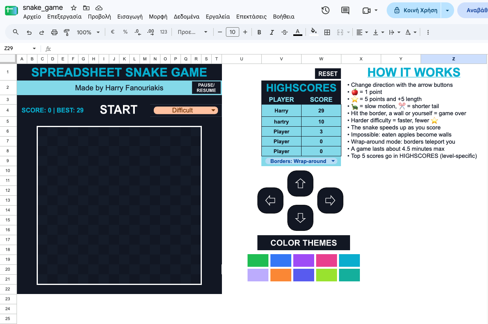
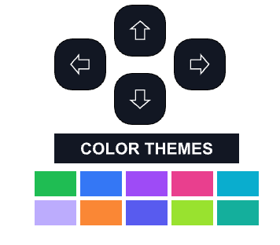

# Spreadsheet Snake 🐍
A fully playable Snake game that runs inside google sheets, built with Apps Script. The board is a grid made up of cells, the controls are clickable buttons drawn on the sheet, and scores are saved in a second tab (+ a small board for the top 5 scores).


## Features
* 16×16 board with checkerboard pattern
* Four difficulty levels (Easy, Medium, Hard, Impossible) that change how fast the snake moves and how often a golden apple shows up
* Apples: 🍎 give you 1 point, ⭐ give 5 points
* Power-ups: 🐢 slows the snake for 25 moves, ✂️ cuts 2 segments off the tail
* The snake speeds up by 20 ms every 5 points (never faster than 100 ms)
* Level obstacles: a new 3-cell wall appears every 10 points
* Impossible mode: every apple you eat turns into a wall
* Wrap-around mode: borders teleport you to the other side instead of killing you
* Pause / resume button
* Continue button: if the time limit is reached, your progress is saved and you can pick up where you left off
* Per-difficulty highscores: top 5 shown on the sheet, plus a BEST score next to the current score
* Death messages: the game tells you if you hit the border, a wall, or yourself
* 10 color themes
  
## How to play
* Pick a difficulty from the dropdown next to START (and a border mode from the dropdown under HIGHSCORES).
* Click START.
* Use the arrow buttons to make turns. You can't turn straight back into yourself (if you do, you die).
* Eat apples, power-ups, and avoid walls, borders (unless wrap-around is on) and your own body.
* When the game ends, enter your name to save your score.
If the time limit is reached, the board freezes and shows TIME UP.

## Setup
### There are 2 ways to play this game:
1. Click this link: https://docs.google.com/spreadsheets/d/1JgnQwj-Nhh1-rJkwk5k4ZEaRAKi9chxPfcI0OvLa6DU/edit?usp=sharing
2. Build it from scratch (more customizable):
  * Create a new Google Sheet.
  * Rename the first tab to game.
  * Open Extensions then click Apps Script, delete the default code, paste in the contents of Code.gs, and press Ctrl+S (or Cmd+S if you're on mac).
  * Back in the sheet, run setup once from the Apps Script editor (or reload the sheet) and grant the permissions it asks for.
  * Set the difficulty dropdown in cell N4 with Data → Data validation → dropdown, using exactly these values: Easy, Medium, Hard, Impossible.
  * Create the buttons (see below).

### Buttons
Create each button with Insert → Drawing (a shape with text), then click the three dots on it and choose Assign script.


```
Button                         Script Name
---------------------------------------------------
START (H4:M4)                  startGame
Up arrow                       goUp
Down arrow                     goDown
Left arrow                     goLeft
Right arrow                    goRight
PAUSE / RESUME                 togglePause
CONTINUE                       continueGame
END & SAVE (optional)          endSavedGame
RESET (clears highscores)      resetScores
Green theme                    themeGreen
Blue theme                     themeBlue
Purple theme                   themePurple
Pink theme                     themePink
Cyan theme                     themeCyan
Orange theme                   themeOrange
Lime theme                     themeLime
Teal theme                     themeTeal
Indigo theme                   themeIndigo
Lavender theme                 themeLavender
```


## How it works
The game saves information like the snake's position, food, walls, score, and direction using JSON in document properties. This allows the buttons and the game to work separately.
Each time the snake moves, `moveSnake` checks the saved information, moves the snake, checks if there's a collision, and updates the board using `setBackgrounds` and `setValues` to keep the game running smoothly.
When you click an arrow button, it saves the new direction. The snake changes direction on its next move.
Unfortunately, Apps Script can only run for about 6 minutes at a time, so the game runs for about 4.7 minutes before stopping.
Scores are saved in the `scores` tab, along with the player's name, score, date, and difficulty. The highscore table shows the best scores for the selected difficulty.

## AI Usage
I used AI while making this project, mainly because I'd never used Apps Script before, and was unfamiliar with all the functions. Moreover, I also used it to fix some bugs and errors and suggest solutions to problems I had.

---
Made by Harry Fanouriakis
